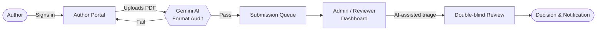

<div align="center">


<br/>

[](https://ncatex.vercel.app/)
[](https://ncatex.vercel.app/login)
[](https://lovable.dev/)


</div>

---

## 🔭 Overview

**NCATEX** (*National Conference on Advanced Trends in Electronics and Telecommunication Engineering*) is a full-stack web platform that runs the entire call-for-papers workflow of an academic conference.

**Authors** register, submit manuscripts, and track their review status. **Reviewers and admins** get a dedicated dashboard to manage submissions. An **AI layer powered by Gemini** validates manuscripts and helps triage them, so formatting problems are caught in seconds, not review rounds.

> 🧠 **Why it exists:** reviewers shouldn't waste time on badly formatted PDFs, and authors shouldn't wait days to learn their margins were wrong.

<div align="center">

### 👉 [**Open the live platform**](https://ncatex.vercel.app/) · [**Go straight to the login portal**](https://ncatex.vercel.app/login) 👈

</div>

---

## ⚡ Try It in 30 Seconds

The login page has **one-click demo access**, so no sign-up is needed.

| Role | Portal | How to enter |
|---|---|---|
| 🎓 **Student / Author** | Submit papers, track review status | Open the [login page](https://ncatex.vercel.app/login) → choose **Student / Author** → click **Student Demo** |
| 🛡️ **Admin / Reviewer** | Dashboard, AI triage, submission management | Open the [login page](https://ncatex.vercel.app/login) → choose **Admin / Reviewer** → click **Admin Demo** |

> 💡 Recruiters: the admin demo shows the more interesting side of the project (the dashboard and the AI-assisted triage).

---

## 📸 Preview

<div align="center">

<!-- Add screenshots to /assets and keep these filenames, or update the paths -->


<br/><br/>

| Login Portal | Conference Tracks | Admin Dashboard |
|:---:|:---:|:---:|
|  |  |  |

</div>

---

## ✨ Features

### 🎓 Author / Student Portal
- 🔐 **Secure sign-in** with a "Remember session" option and password recovery
- 📤 **Paper submission** across five research tracks
- 🔎 **Track Paper:** follow the status of a submission through peer review
- 🤖 **AI manuscript format audit:** upload a PDF and get instant validation against the IEEE double-column format (max 6 pages)
- 💬 **AI-assisted guidance** to clear doubts about the submission process

### 🛡️ Admin / Reviewer Portal
- 📊 **Admin dashboard** with role-based access
- 🧪 **AI-powered triage** that helps screen incoming submissions faster
- 📣 **Live announcements:** official notices that appear on the public site

### 🌐 Public Website
- 🗓️ **Interactive milestone timeline** (Done · Upcoming · Open)
- 🧬 **Track explorer** with focus areas for each domain
- ❓ **FAQ** on eligibility, formatting, fees and indexing
- 🎠 Testimonial carousel and an animated partner marquee
- 🌗 **Light / Dark theme toggle**
- 📱 **Fully responsive** from phones to ultra-wide screens
- 🧮 LaTeX-aware content rendering

---

## 🏗️ How It Works



---

## 🧬 Research Tracks

| # | Track | Focus areas |
|:-:|---|---|
| 01 | **AI / ML** | Neural networks · Edge AI · Computer vision |
| 02 | **VLSI** | 28nm/7nm flows · RISC-V · SoC design |
| 03 | **5G Communication** | Beamforming · Network slicing · Terahertz |
| 04 | **IoT** | LoRaWAN · Edge sensing · Industrial IoT |
| 05 | **Signal Processing** | Biomedical DSP · Radar array · Wavelet transform |

---

## 🗓️ Milestones

```text
Jan 15     ✅  Call for Papers opens
Feb 20     ⏳  Paper submission deadline (IEEE 2-column, max 6 pages)
Mar 05     📬  Peer review & acceptance notification
Mar 15     📝  Camera-ready manuscript submission
Apr 10–11  🎤  Official conference sessions (hybrid)
```

---

## 🛠️ Tech Stack

<div align="center">

| Layer | Technology |
|---|---|
| **Framework** | TanStack Start (React) |
| **Language** | TypeScript |
| **Build tool** | Vite |
| **UI** | Component-driven design with a shadcn/ui setup |
| **Authentication** | Role-based auth (Student / Admin) |
| **AI** | Google Gemini for manuscript validation and admin triage |
| **Quality** | ESLint · Prettier · Vitest |
| **Package managers** | npm / Bun |
| **Hosting** | Vercel |
| **Prototyping** | Lovable |

</div>

---

## 🚀 Run It Locally

**Prerequisites:** [Node.js](https://nodejs.org/) (LTS) and npm.

```bash
# 1. Clone the repository
git clone https://github.com/jagtapmansis006-glitch/YOUR-REPO-NAME.git

# 2. Enter the project folder
cd YOUR-REPO-NAME

# 3. Install dependencies
npm install

# 4. Start the development server
npm run dev
```

Open **http://localhost:5173** 🎉

### 🔐 Environment variables

Create a `.env` file in the project root:

```env
GEMINI_API_KEY=your_api_key_here
```

> ⚠️ Never commit `.env` or real API keys. Set them in your hosting provider instead (for example, Vercel → Project Settings → Environment Variables).

### 📜 Scripts

```bash
npm run dev       # start the dev server
npm run build     # production build
npm run lint      # lint the code
npm run test      # run unit tests
```

---

## 📁 Project Structure

```text
.
├── public/           # Static assets
├── scripts/          # Utility & maintenance scripts
├── src/              # Application source (routes, components, logic)
├── AGENTS.md         # Notes for AI coding agents
├── components.json   # UI component configuration
├── vercel.json       # Vercel build & routing configuration
├── vite.config.ts    # Vite configuration
└── vitest.config.ts  # Test configuration
```

---

## 🌐 Deployment

Deployed on **Vercel** with continuous deployment:

```text
git push  →  GitHub  →  Vercel build  →  https://ncatex.vercel.app 🚀
```

---

## 🗺️ Roadmap

- [x] Role-based login (Student / Admin)
- [x] Paper submission & tracking
- [x] AI format validation layer
- [x] Admin dashboard & AI triage
- [x] Light / dark theme
- [ ] Reviewer assignment & scoring workflow
- [ ] Automated email notifications
- [ ] Camera-ready & copyright form uploads

---

## 👩‍💻 Author

<div align="center">

**Mansi Sanjay Jagtap**
Full-Stack & Frontend Developer · EXTC Student, University of Mumbai

[](https://portfolio-ten-snowy-jwdi2pvbne.vercel.app/)
[](https://github.com/jagtapmansis006-glitch)

<br/>

**Open to internships and collaborations. Let's build something great together.**

</div>

---

<div align="center">

⭐ **If you find this project useful, please star the repo!** ⭐

<sub>© NCATEX · All rights reserved</sub>


</div>
